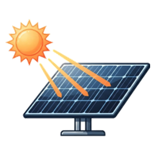

# PV Übersicht – Home Assistant Integration

Du gibst nur **einen Sensor mit der aktuellen PV-Leistung** (W oder kW) an – die Integration rechnet daraus Energie und Statistiken.

## Installation über HACS

1. HACS → Menü (⋮) → **Benutzerdefinierte Repositories**
2. Repository `https://github.com/berwil84afk/ha-pv-overview`, Typ **Integration** → Hinzufügen
3. „PV Übersicht“ in HACS suchen → Herunterladen → Home Assistant neu starten
4. **Einstellungen → Geräte & Dienste → Integration hinzufügen → „PV Übersicht“**

## Manuelle Installation

1. Ordner `custom_components/pv_overview` nach `/config/custom_components/pv_overview` kopieren
   (z. B. mit dem File-Editor- oder Samba-Add-on).
2. Home Assistant neu starten.
3. **Einstellungen → Geräte & Dienste → Integration hinzufügen → „PV Übersicht“**.
4. Name, PV-Leistungssensor, Schwelle (Standard 10 W) und optional den bisherigen Zählerstand eingeben.

Später änderbar über **Konfigurieren** an der Integration: Quellsensor und Schwelle.

## Erzeugte Sensoren

| Sensor | Einheit | Beschreibung |
|---|---|---|
| Aktuelle Leistung | W | Leistung des Quellsensors in W (kW wird umgerechnet, negativ → 0) – Grundlage aller Berechnungen, sofort aktualisiert |
| Gesamtproduktion | kWh | Fortlaufender Zähler – im **Energie-Dashboard** als Solarproduktion nutzbar |
| Produktion heute / gestern | kWh | `gestern` hat Attribut `history` mit den letzten 30 Tagen |
| Produktion diese Woche / dieser Monat / letzter Monat / dieses Jahr | kWh | `dieser Monat` hat Attribut `months` mit Monatswerten |
| Spitzenleistung heute | W | Attribut `time` = Zeitpunkt |
| Spitzenleistung Rekord | W | Allzeit-Maximum mit Zeitpunkt |
| Durchschnittsleistung heute | W | Ø Leistung während der Produktionszeit |
| Produktionszeit heute | h | Zeit über der Schwelle |
| Ø Tagesproduktion 7 / 30 / 365 Tage / gesamt | kWh/d | Nur abgeschlossene Tage |
| Bester Tag | kWh | Attribut `date` |

## Wie gerechnet wird

- Energie = Leistung × Zeit (Riemann-Summe, Wert gilt bis zur nächsten Änderung), aktualisiert alle 30 s.
- kW/MW-Sensoren werden automatisch in W umgerechnet, negative Werte als 0 gewertet.
- Ist der Quellsensor `unavailable`, wird über die Lücke **nicht** integriert. Während Home Assistant aus ist, wird nichts gezählt.
- Tage, Wochen (ISO, ab Montag), Monate und Jahre werden um Mitternacht abgeschlossen – auch wenn HA über Mitternacht aus war.
- Der Tag der Ersteinrichtung ist unvollständig und zählt nicht in die Durchschnitte.
- Daten liegen in `/config/.storage/pv_overview.<entry_id>` und überleben Neustarts.

## Beispiel-Dashboard

Entity-IDs ggf. anpassen (abhängig vom gewählten Namen, hier „PV Anlage“):

```yaml
type: vertical-stack
cards:
  - type: glance
    title: PV heute
    entities:
      - entity: sensor.pv_anlage_produktion_heute
        name: Heute
      - entity: sensor.pv_anlage_spitzenleistung_heute
        name: Spitze
      - entity: sensor.pv_anlage_durchschnittsleistung_heute
        name: Ø Leistung
      - entity: sensor.pv_anlage_produktionszeit_heute
        name: Laufzeit
  - type: entities
    title: PV Übersicht
    entities:
      - sensor.pv_anlage_gesamtproduktion
      - sensor.pv_anlage_produktion_gestern
      - sensor.pv_anlage_produktion_diese_woche
      - sensor.pv_anlage_produktion_dieser_monat
      - sensor.pv_anlage_produktion_letzter_monat
      - sensor.pv_anlage_produktion_dieses_jahr
      - type: divider
      - sensor.pv_anlage_o_tagesproduktion_7_tage
      - sensor.pv_anlage_o_tagesproduktion_30_tage
      - sensor.pv_anlage_o_tagesproduktion_gesamt
      - sensor.pv_anlage_bester_tag
      - sensor.pv_anlage_spitzenleistung_rekord
  - type: statistics-graph
    title: Tagesproduktion
    entities:
      - sensor.pv_anlage_produktion_heute
    stat_types:
      - max
    period: day
    days_to_show: 30
    chart_type: bar
```
